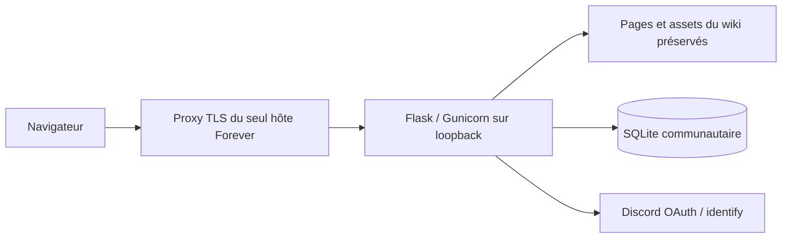

# Phase A — audit du dépôt et choix techniques

Date : 30 octobre 2026. Dépôt identifié : `https://github.com/eyna4ever/wow4ever.git`, commit initial `9b51f381bba732e084157b7335afb5f6f503c3b5`, branche par défaut `main`.

## Identification

À la base auditée, `install.sh` désignait explicitement le domaine `wow4ever.raveforge.eu`, le dépôt ci-dessus et `/var/www/wow4ever`. Les URL canoniques des pages et le sitemap correspondent au même domaine. Selon la revue fournie ensuite, le site actuel est en réalité sous `/srv/wow4ever` ; cette information n’a pas été vérifiée par Codex sur le serveur. Le dépôt a été cloné dans `/workspace/wow4ever`, séparément de `/workspace/ForgeCraft`. Aucun fichier de ForgeCraft ou d’un autre projet n’a été modifié. Branche dédiée : `codex/community-redesign`.

La consultation publique du domaine avec l’outil web a échoué. Le script est une preuve d’association du dépôt au domaine, pas une preuve de la révision effectivement déployée. Aucun accès au serveur de production n’a été utilisé. Les maquettes annoncées ne figuraient pas dans les pièces accessibles : conformité visuelle à vérifier avec leur propriétaire.

## Existant

| Élément | Constat |
| --- | --- |
| Wiki | 100 pages HTML bilingues sous `fr/` et `en/`, sélecteur de langue racine |
| Présentation | CSS partagé, Cinzel auto-hébergée sous OFL, illustrations SVG locales |
| JavaScript | Navigation mobile, langue, recherche sur index JSON, compte à rebours, comparateur |
| Hébergement prévu | Caddy en mode fichiers statiques, script shell d’installation |
| Serveur / données | Aucun serveur applicatif, aucune base, aucun système de comptes dans la révision auditée |
| QA / automatisation | Aucun test ni manifeste applicatif présent à la base |
| Consignes locales | Aucun `AGENTS.md` dans le dépôt cloné ni à sa racine parente accessible |

Le script historique effectuait un `git pull`, pouvait supprimer son répertoire cible et rechargeait Caddy. Cette version n’a pas été exécutée. Suite à la revue, `install.sh` est remplacé par un garde qui échoue immédiatement sans mutation. Le script d’origine reste consultable uniquement dans l’historique Git.

## Architecture retenue

Le serveur autorise explicitement les chemins publics du wiki. Une feuille `community.css` unifie les couleurs bleu nuit, noir et or ; les pages reçoivent des liens communautaires. Les paragraphes, listes, sources, scripts, URL et données de recherche du wiki sont conservés. Un test compare chaque page bilingue à la base en retirant seulement ces ajouts.

Flask, Jinja et SQLite ajoutent le strict nécessaire au site existant, sans migration vers une SPA ni remplacement de ses contenus. Formulaires rendus côté serveur, utilisables sans JavaScript. Requêtes paramétrées ; échappement automatique de tout contenu utilisateur. Schéma versionné et initialisation additive idempotente.

SQLite WAL convient à une communauté initiale sur un serveur unique ; pas de stockage réseau/NFS ni de réplication horizontale. Définir des seuils d’occupation, de latence et d’attente d’écriture en préproduction. Une migration vers PostgreSQL devra être étudiée si la charge l’exige.

## Ordre de réalisation

1. Branche isolée, audit, préservation et plan de données.
2. Sessions, CSRF, OAuth, permissions puis forums, profils, interactions et modération.
3. Thème partagé, états vides réels et vérifications navigateur.
4. Tests fonctionnels et de sécurité, audit de dépendances, correctifs.
5. Préproduction privée préparée, configuration opérateur et procédures de retour arrière.

Aucune fusion, modification de production, publication ni connexion SSH à un serveur tiers n’est comprise dans cette livraison locale.
